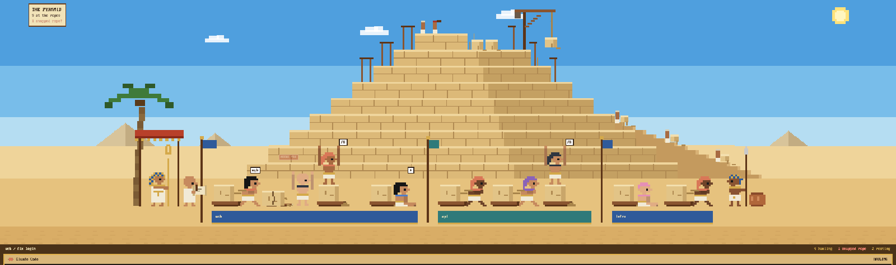

# herdr-pyramid-layout

The **Pyramid** layout for the Herdr app: a pixel-art building site in the Egyptian desert where
every coding agent is a hauler dragging a limestone block on a sledge towards a pyramid under
construction. You can tell at a glance who is leaning into the rope, whose rope snapped and needs
you, and who delivered their block and is stretching on top of it. See
[pyramid/RECIPE.md](pyramid/RECIPE.md) for how it is built.



## Installation

Ask your agent to add this layout (it reads every file first), or do it by hand:

1. Copy `pyramid/layouts/*` into `~/.config/herdr-app/layouts/`.
2. Copy `pyramid/mods/pyramid` into `~/.config/herdr-app/mods/`.
3. Pick **pyramid** in the Herdr settings, or run:
   ```sh
   herdr-app do layout.switch --name pyramid
   ```

`ctrl-shift-l` cycles back to your previous layout. Delete the copies to remove it.

There is nothing else to install: the pixel font ships with the mod. The mod makes no network
requests, runs no programs of its own and reads no files outside its folder. Clicking a spare
block opens a new tab running your most-used installed agent (Herdr's `tab.new`).

## The site

| Hauler | Block | Agent status |
| --- | --- | --- |
| Leaning into the rope, straining forward and back | sliding on its sledge, dust puffing | working |
| Jumping, arms up, under a blinking **NEEDS YOU** | **rope snapped**: block cracked in the sand, sledge broken | blocked: waiting for you |
| Standing on top of the block, stretching, humming ♪ | delivered, rope coiled | done while you weren't looking |
| Sitting against the block | resting on its sledge | idle |

- Each Herdr space (project) is a team with its own standard pole, fluttering flag and a banner
  in the sand with its name.
- Every hauler looks different (skin, headcloth, wig, cap or bald), and their headcloth and collar
  colour follows the kind of agent.
- While anyone hauls, the scribe writes, the crane on the pyramid hoists a block, a worker on the
  top course swings a mallet and tiny haulers drag blocks up the ramp. The pharaoh watches from
  under a red canopy; a guard with a spear stands at the far end.
- The sky goes from day to sunset to night with the clock. Clouds and birds drift, the sand
  ripples, and torches glow at night.
- Click a hauler to jump to that agent. Hover a site for a papyrus note with its tab, space,
  title and status.
- The site grows or shrinks to fit any number of agents and stays crisp.

Under the scene, a strip shows the current space and tab and counts of agents hauling, with
snapped ropes and resting. Your terminals sit below in dark frames with sandstone headers.

## Credits

- Built on the structure of [herdr-galley-layout](https://github.com/ondrapopik/herdr-galley-layout),
  itself built on [herdr-office-layout](https://github.com/zuccs/herdr-office-layout) (MIT).
- Font: [PxPlus IBM VGA 8x16](https://int10h.org/oldschool-pc-fonts/) by VileR, CC BY-SA 4.0
  (licence in `pyramid/mods/pyramid/fonts/`).

## License

Code: [MIT](LICENSE). The bundled font keeps its own CC BY-SA 4.0 licence.
