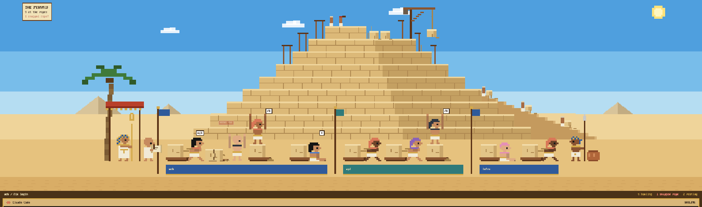

# Pyramid

A pixel-art pyramid building site for the Herdr app. Every agent is a hauler dragging a limestone
block on a wooden sledge. You can see at a glance who is leaning into the rope, whose rope snapped
(their block lies cracked in the sand while they wave for you), and who delivered their block and
is stretching on top of it. A stepped pyramid with scaffolding, a crane and a ramp rises behind
them. The scene fills the top of the window, a dark strip runs under it, and your terminals sit
below in dark frames with sandstone headers.

## What you see

One fixed look: no system title bar, root background `#4a3218`, theme `graphite` with
`background #1f1a14`, `accent #e0b04a`, `border #4a3218`, terminal font size 13. Pixel text is
`PxPlus IBM VGA 8x16` (shipped in `mods/pyramid/fonts/`). Nothing is rounded. From top to bottom:

1. **The site**, weight 1.15. Dragging it moves the window. All art is drawn in *art units* of `s`
   screen px, measured from the scene's left end `x0` and the ground line `G` where the haulers
   stand (up is negative).
   - **Sky**: three bands that get lighter toward the horizon (`G - 30s`). Day is
     `#4f9fde / #78bdea / #b5ddf2` with a pixel sun top right and three drifting clouds. Sunset
     (17–19h) is `#c9685a / #ec9a5a / #f6c47a` with a low orange sun. Night (19–6h) is
     `#141b3a / #1d2547 / #27305a` with 30 stars and a crescent moon. In daylight two dark birds
     (`v` / `-` / `^`) fly across.
   - **Distant pyramids**: three smooth hazy triangles on the horizon (`#d8c49a` lit side,
     `#c2ac82` shaded side by day) at `0.14·w`, `0.24·w` and `0.88·w`, plus low dunes.
   - **Desert**: `#efd49a` from the horizon, `#e6c27e` from `G - 14` and `#d9ad66` from `G + 10`,
     with rows of sand ripples (`#b8884a55`) every 12px drifting to and fro.
   - **Pyramid**, centred over the row of haulers, base width `0.85 ×` the row (96–220 units),
     5–9 courses 8 units tall, base at `G - 14`, top course 22% of the base wide. Each course is
     `#dcb978` with a `#efd59c` top edge, its right 38% shaded `#c4a062`, a half-height seam and
     staggered block joints every 12 units (`#b08a52`). The top course is only 55% laid, with two
     loose blocks beside it. Wooden scaffolding stands around the top three courses. A crane
     (post, boom, brace) sits on the second course from the top. A mud-brick ramp (`#c49a5e`,
     lighter `#d8b276` edge) climbs the right face up to the fourth course, with three tiny
     haulers dragging small blocks.
   - **Teams**: each space (project) gets a standard pole (`#5c3418`, gold cap) with a fluttering
     flag where its sites start, and a banner 6 units tall in the sand under its sites, with the
     space name in the pixel font and a gold fringe. Colours: red, blue, green, gold, purple and
     teal, fixed by the space id and never the same as the neighbouring space. Teams are 8 units
     apart.
   - **Court** (left, 40 units): a leaning palm, a red canopy with a gold fringe over the
     **pharaoh** (blue-and-gold striped headdress, gold collar, white robe, gold ankh staff), and
     a bald **scribe** in white holding a papyrus.
   - **Sites**: one per agent, 26 units apart: a 14-unit sledge (`#8a5530` / `#5c3418`), a
     10×8.5 limestone block (`#e2c487`, highlight `#f3dfae`, shade `#c9a66a`), a rope (`#a8844a`)
     and the hauler. Haulers face right, towards the pyramid. Each has a random but stable look:
     skin (6 tones), head (headcloth, black wig, cap or bald), white kilt (`#f1ead6`) and gold
     belt. The headcloth and collar follow the agent kind (`claude #d97757`, `codex #2f3640`,
     `gemini #4f7dc9`, `opencode #8a62b8`, `pi #e58fb6`, ...), otherwise a random linen or colour.
   - **Guard** (right, 26 units): a guard with a blue-and-gold headcloth and a spear, and two clay
     water jars.
   - **Sign**, top left at x 84 (clear of the macOS window buttons): a parchment card `#f1e3b8`
     with a 3px `#6b3f1f` border. It reads `THE PYRAMID` (16px) over `N at the ropes` (12px),
     plus a blinking red `K snapped rope(s)!` while any agent is blocked.
2. **Strip**, 28px `#4a3218`: `space / tab` in `#f1e3b8` on the left. On the right, in `#d4a94a`:
   `N hauling`, `N snapped ropes` (`#ff8a7a`, shown only when there are any) and `N resting`.
3. **Terminals**, weight 1, 10px side padding: the active tab. Every pane, a lone one too, sits
   in a 4px `#2e2010` frame (`#e0b04a` when focused), 10px apart, with a 26px `#d9b77a` header.
   The header shows the program icon and name, and the status in capitals on the right:
   `HAULING`, `ROPE SNAPPED - NEEDS YOU` (in `#8a1f18`), `DONE - RESTING` or `IDLE`.

## How it behaves

- **working**: the hauler leans forward into the rope over their shoulder. The whole site
  (sledge, block, rope, hauler) strains 2 units forward and back over one 1400ms heave, the
  hauler bobs, and a dust puff blinks behind the sledge. While anyone works, the scribe's stylus
  moves, the crane hoists its block up and down, a mallet swings on the top course and the tiny
  haulers walk up the ramp. Now and then a bubble says `heave!`, `pull!`, `ugh` or `...`.
- **blocked** (needs you): **rope snapped**. The block has slid off a broken sledge and lies
  cracked in the sand with rubble and a frayed rope end. The hauler jumps (600ms) with both arms
  up, under a blinking red `NEEDS YOU` plate, or a `!` bubble when a site is narrower than 60px.
- **done** (finished while you weren't looking): the block is delivered and the rope coiled.
  The hauler **stands on top of the block and stretches**, arms going up and down, and a
  `♪` / `♪♫` / `♫` bubble plays.
- **idle / unknown**: the hauler sits on the sand leaning against the block, legs stretched out.
  Now and then a bubble shows `♪`, `...`, `?`, `☼` or `zZ`. A done agent turns idle once you look
  at it, so only finished agents you haven't checked stand.
- **Spare sites**: the row always has at least four sites. A spare one shows a block on its
  sledge with the rope lying in the sand.
- **Clicks and hovers**: each site has a hit area from 30 units above the ground to 10 below.
  Clicking a hauler runs `agent.focus`. Clicking a spare site opens a tab in that team's space
  with the first installed agent from `knownAgents()`. Hovering shows a papyrus note (200px):
  tab, space, title, status (`Spare block` / `click: put an agent to work` on a spare). Site
  order follows `agents()` and is passed to `setAgentOrder`.
- **Night** (19–6h): the scene dims under `#0b123660`, and three torches (canopy, guard, pyramid
  top) glow over the tint with flickering flames. 17–19h gets a warm `#f2a65a1a` tint.
- **Fit**: the scene is `40 + sites·26 + (teams-1)·8 + 26 + 8` units wide and 112 units tall.
  `s = min(6, (w-32)/width, (h-8)/112)`, floored to half pixels, at least 1. The scene is centred
  horizontally, and the ground line sits at `max(98s, (h - 112s)/2 + 98s)`.

## Built from

- `layouts/pyramid.json`: a `column` of three blocks. `pyramid-site` holds mod `pyramid` and has
  `window_drag`. `pyramid-rail` holds mod `pyramid` with props `{role: "rail"}`.
  `pyramid-quarry` is `{tab: "active"}` with a pane frame whose header is mod `pyramid` with
  props `{role: "pane"}`. `preview` points at `layouts/pyramid.svg`.
- `mods/pyramid/art.js`: sprites as rows of palette letters (`sprite(rows, palette, s)` draws one
  `div` per run of a colour), haulers in four poses (`pull`, `help`, `stand`, `sit`) built from a
  head (4 styles) and a body, `block` and `sledge`, the `court` (palm, canopy, pharaoh, scribe,
  guard, jars), `backdrop` (sky, distant pyramids, desert, clouds, birds), `pyramidGeo` and
  `pyramid` (courses, scaffolding, crane, ramp, tiny workers) and `torches`. Per-hauler looks
  are seeded from a hash of the agent's address.
- `mods/pyramid/main.js`: one mod with three roles chosen by `props().role`. The scene is drawn in
  layers: backdrop → pyramid → team poles and banners → court → sites → night tint and torches →
  bubbles → hit areas → hover note → sign. Each site is one box positioned from 30 units above
  the ground, so a working site's `left` loop moves block, rope and hauler together. A 1s timer
  only rolls thought bubbles and watches the minute (for day and night), and it calls
  `cx.notify()` only on a change. Every movement is a native `loop` or `frames`.
- **The ramp walkers**: a diagonal move without two loops on one element. An outer box loops
  `left`, an inner box loops `top` with the same period, both `linear`, started in the same
  render, so together they walk up the slope. The crane does the same with the rope's `height`
  and the block's `top`.
- `props: {demo: true}` on `pyramid-site` fills the site with 9 sample haulers in every state, in
  three teams, with three times as many thought bubbles. On `pyramid-rail` it shows
  `web / fix login` and the sample crew's counts. `props: {hour: 21}` on `pyramid-site` fixes the
  hour, to preview sunset or night. The preview was taken with `demo`, so no real names show.
- Uses `agents()`, `spaces()`, `panes()`, `knownAgents()`, `run("agent.focus")`, `run("tab.new")`
  and `setAgentOrder`. No network, no `exec`, no files outside its folder.

## Watch out

- Loops are ping-pong (there and back) with no phase offset. A working site strains forward and
  back rather than travelling, and the ramp walkers walk back down the way they came.
- Loops and frames need a stable `.id()`, or they restart on every render.
- Give the root element an id that is unique per mod instance (`pyramid-root-<seed>`). Then
  `on_size_change` fires for a fresh copy after a props change or hot reload, instead of the copy
  keeping its 1200×440 default.
- Every clickable site stops `on_mouse_down`, because the block has `window_drag`.
- Notify only on real hover changes: a redraw reports hover again, so an unconditional
  `cx.notify()` in `on_hover` loops.
- Elements inside a site box or a moving box use local coordinates; only top-level art uses
  `X()` / `Y()` from `x0` and `G`.
- More than about 35 agents on a narrow window drives `s` down to 1. Team names on the banners
  disappear when the banner text would be smaller than 8px.
- `PxPlus IBM VGA 8x16` is CC BY-SA 4.0 (VileR, int10h.org): keep its licence file with it.

## Done when

- `herdr-app check mods/pyramid` passes, `layout.switch {"name":"pyramid"}` shows the site with
  one hauler per running agent, and `herdr-app status` reports no new errors.
- A working agent's hauler strains at the rope and its block slides to and fro; the crane hoists
  and the tiny haulers climb the ramp. Two `herdr-app shot`s a third of a second apart differ.
- When an agent asks for permission, its rope snaps: the block lies cracked off a broken sledge
  and the hauler jumps under a blinking `NEEDS YOU`. The pane header reads
  `ROPE SNAPPED - NEEDS YOU` and the sign shows `1 snapped rope!`.
- When an agent finishes while you are elsewhere, its hauler stands on the block, stretches and
  hums `♪`. After you look at it, they sit back down against the block (idle).
- Clicking a hauler focuses that agent's terminal. Hovering a site shows its papyrus note.
- After 19h the scene goes dark with a moon and stars, and the torches glow.
